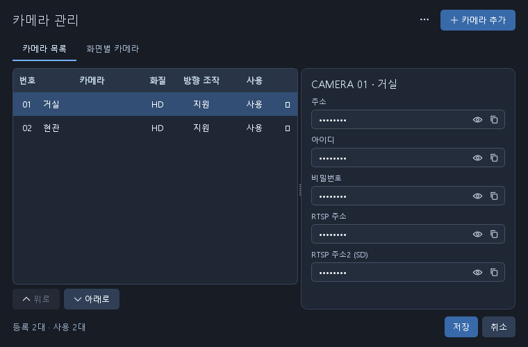

# CamFloat - RTSP Stream Viewer

RTSP 카메라를 **작고 깔끔한 창으로** 보는 Windows용 무료 플레이어입니다.
다른 작업을 하면서 카메라 1~4대를 함께 볼 수 있습니다.

**[다운로드](https://github.com/xogn1004/CamFloat/releases/latest)** · [사용 안내](docs/user-guide.md) · [변경 내역](CHANGELOG.md)

## 주요 기능

- **1·2·4분할** 동시 재생 · 2분할 좌우/상하 전환
- **프레임 없는 창** · 마우스로 이동/크기 조절 · 항상 위에 · 투명도 조절
- **화면별 소리 조절** · 개별/전체 음소거 · HD/SD 선택
- **빠른 확대와 전체화면** · 다른 화면의 연결은 유지
- **카메라 관리** · 분할별 화면 배정 · 목록 내보내기/불러오기
- **카메라 방향 조작** · 짧게·길게 누르기 · 외부 제어 포트 설정

## 시작하기

1. [Releases](https://github.com/xogn1004/CamFloat/releases/latest)에서 **`CamFloat-1.1.0-win-x64.zip`**을 내려받습니다.
2. 압축을 **모두 풀고** `CamFloat.exe`를 실행합니다.
3. **카메라 관리 → 카메라 추가**에서 연결 정보를 입력하고 **추가**를 누릅니다.
4. 관리창에서 **저장**을 누르면 재생을 시작합니다.

Windows 64비트용입니다. **VLC를 별도로 설치할 필요가 없습니다.**
첫 실행에는 바탕화면·작업 표시줄 바로가기를 선택하거나 건너뛸 수 있습니다.
`CamFloat.exe`만 옮기지 말고 `_internal`과 `licenses`를 포함한 폴더 전체를 보관해주세요.
업데이트할 때는 앱을 종료하고 새 배포본을 실행하면 됩니다. 저장한 카메라와 설정은 유지됩니다.

EXE에 코드 서명이 없어 Windows에서 **‘알 수 없는 게시자’** 등의 경고가 표시될 수 있습니다.

## 자주 쓰는 조작

| 조작 | 기능 |
| --- | --- |
| 상단 중앙에 마우스 올리기 / Alt | 앱 도구 표시 |
| 1 / 2 / 4 | 화면 분할 · 이미 2분할이면 좌우/상하 전환 |
| 영상 더블클릭 | 해당 화면 확대 · 기본 1분할에서는 전체화면 |
| F11 / Esc | 전체화면 / 확대 복원·전체화면 해제 |
| Ctrl+M | 카메라 관리 |
| F1 | 사용법 / 정보 |

단축키는 CamFloat에서 작업할 때 동작합니다. 자세한 조작은 [사용 안내](docs/user-guide.md)를 참고하세요.

카메라 관리 화면

## 카메라 정보

이 PC의 설정은 Windows 계정에 연결해 암호화합니다. 비밀번호·RTSP 주소를 보거나 복사할 때는 Windows 본인 확인이 필요합니다.

**내보낸 `.camfloat` 파일에는 접속 정보가 들어 있습니다. 파일을 가진 사람은 CamFloat로 열 수 있으니 신뢰하는 사람에게만 전달해주세요.**
문제 신고에는 카메라 주소·계정·설정 파일을 올리지 마세요.

## 개발과 라이선스

- [개발 안내](docs/development.md) · [검토·검사 요약](CODE_REVIEW.md) · [후속 개발 계획](docs/post-release-plan.md)
- [보안 안내](SECURITY.md) · [외부 라이브러리 고지와 소스](THIRD_PARTY.md)
- CamFloat 소스: **[MIT 라이선스](LICENSE)**. 포함된 외부 라이브러리는 각각의 라이선스를 따릅니다.
